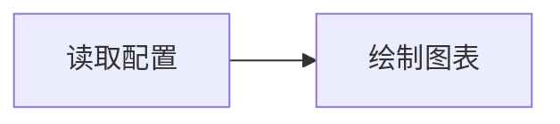

# 博客功能与 DistinctionPP 内容语法

## 站点功能与入口

| 要查的功能 | 本站的行为 | 从哪里查 |
| --- | --- | --- |
| 文章与资源 | Hugo 用 Goldmark 渲染 `source/`。文章路径为 `/:year/:contentbasename.html`。`source/post` 同时是静态目录，同年目录的文件可由文章页面按相对 URL 引用。 | [站点配置](../config.yaml) |
| Markdown 正文 | 已启用表格、脚注、定义列表、任务列表、删除线和自动链接，支持标题及块属性。已有标题的显式 `{#id}` 可被目录或站内链接引用。 | [Goldmark 配置](../config.yaml) |
| 首页、分类、标签与归档 | 首页和分类、标签的条目页使用分页卡片，显示日期、标题、富文本摘要和标签。归档总览提供最近文章、分类和标签入口。RSS 链接按页面输出格式生成。 | [卡片模板](../themes/distinctionpp/layouts/partials/archive-post.html)、[归档总览](../themes/distinctionpp/layouts/archives/list.html) |
| 单篇阅读 | 文章有折叠目录、分类标签、前后篇导航和评论入口。目录层级由 `markup.tableOfContents` 配置，文章与独立页面使用不同模板。 | [文章模板](../themes/distinctionpp/layouts/partials/article.html)、[页面模板](../themes/distinctionpp/layouts/partials/page.html) |
| 站点集成 | 搜索框提交到配置的 Bing 站内搜索。本站配置了 Utterances 评论，主题也有按配置启用的 Disqus 模板。GA、广告位及按域名显示的备案信息分别由配置和模板控制。 | [配置](../config.yaml)、[评论](../themes/distinctionpp/layouts/partials/comments.html)、[主题说明](../themes/distinctionpp/README.md) |
| 构建与发布 | Hugo 生成静态站点。发布脚本调用 Python 适配器编译 D2 和 PlantUML，再生成最终 HTML。 | [构建适配器](../scripts/build-d2.py)、[发布脚本](../deploy.sh)、[CI](../.github/workflows/main.yml) |

## Markdown 图片引用的分派

阅读或修改 `` 时，先查目标的完整后缀。主题按以下顺序处理。[图片 render hook](../themes/distinctionpp/layouts/_default/_markup/render-image.html)

1. 下表中的图表后缀进入对应渲染器。后缀匹配忽略大小写，针对整个目标字符串。给图表文件名追加查询串或片段会改变匹配结果。
2. 本地相对路径如果不在普通图片后缀清单中，就按外部代码文件读取。例如 `` 展示 JSON 源码，`` 绘制 Chart.js 图表。要提供下载或打开文件的入口，用普通 Markdown 链接。
3. 普通图片输出 ``。识别的后缀有 `.apng .avif .bmp .gif .ico .jfif .jpeg .jpg .png .svg .tif .tiff .webp`。相对图片 URL 以文章的发布目录为基准，列表复用摘要时也能定位原图。以站点根目录、协议或片段开头的目标不走外部代码分支。

标题末尾的 `{...}` 用空格分隔 `参数=值`，其前的文字保留为标题。解析器按空格和等号切分，值含空格或额外等号时，用支持该参数的 shortcode 或 CSS class。普通图片实际输出 `max-width`、`max-height`、`class`、`style`，要设置宽度可写 `style=width:80%`。图表的 `width`、`height` 设置的是容器尺寸。

~~~markdown

~~~

**文章横幅**在正文中单独声明一次。下面使用 2612 的真实图片和像素尺寸，仅在文章列表卡片展示。

~~~markdown

~~~

`list` 和 `single` 默认均为 `true`。`list-position` 可取 `before-title`、`before-summary`（默认）或 `after-summary`。`single-position` 可取 `before-title`、`after-title`、`before-content`（默认）或 `after-content`。位置由模板决定。共享及页面专属的 class、style 都作用在横幅容器上，例如 `list-style="--banner-height: 9rem; --banner-focus: center 35%"`。需要预留图片空间时一起填写原图的 `width`、`height`。未声明横幅的旧文章仍可由列表模板提取摘要开头的独立图片。[横幅参数和 CSS 变量](../themes/distinctionpp/README.md#banner)

## 图表引擎与输入

八种图表都支持四种入口。短图可用带语言的围栏，独立资源可用图片语法。Shortcode 适合带多个属性或需要指定引擎的内容，可用 `src` 引用外部文件，也可将源文本放在成对标签之间。文件型图表 shortcode 可沿用 2602 中的成对写法。[四种入口的实际文章](../source/post/2026/2602.md)

| 引擎 | 图片引用的后缀 | 围栏语言 | Shortcode 名称 | 输入与渲染 |
| --- | --- | --- | --- | --- |
| Mermaid | `.mermaid` | `mermaid` | `mermaid` | Mermaid 文本，浏览器生成 SVG |
| Draw.io | `.drawio`、`.dio` | `drawio` | `drawio` | diagrams.net XML，浏览器查看器。围栏或 shortcode 可用 `page` 选择画页，默认 0 |
| Excalidraw | `.excalidraw` | `excalidraw` | `excalidraw` | Excalidraw 场景 JSON，浏览器渲染 |
| Chart.js | `.chart.json` | `chart`、`chartjs` | `chart` | 图表配置 JSON，包含 `type` 和 `data`，浏览器绘制 canvas |
| ECharts | `.echarts.json` | `echarts` | `echarts` | option JSON。3D 图可用 `extensions="gl"` 加载 ECharts-GL |
| Plotly.js | `.plotly.json` | `plotly` | `plotly` | 包含 `data` 的 JSON，可加 `layout`、`config`。例如 `extensions="gl3d"` |
| D2 | `.d2` | `d2` | `d2` | D2 源文本，构建时生成内联 SVG |
| PlantUML | `.puml`、`.plantuml` | `plantuml` | `plantuml` | 一组 `@startuml` 和 `@enduml`，构建时生成内联 SVG |

以下是可执行的文章语法。文件示例使用 [2602 的 ECharts 配置](../source/post/2026/2602-test-echarts-3d.echarts.json)。

~~~~markdown




flowchart LR
    A --> B

~~~~

- 围栏属性写在首行语言名后，例如 `echarts {extensions="gl" height="500px"}`。图片引用用标题末尾的属性块，shortcode 用命名参数。图表的 `width`、`height`、`max-width`、`max-height` 使用 CSS 尺寸值。某些参数只在特定入口读取，例如 Draw.io 的 `page`。
- Chart.js、ECharts 和 Plotly 的上述专用入口使用 JSON。Plotly 每页选择一个脚本包。默认图与扩展图混用，或同页需要多个不同扩展包时，加载完整包。ECharts 在核心包上追加所需扩展。[浏览器加载器](../themes/distinctionpp/layouts/partials/after-footer.html)
- 浏览器图表可由模板内嵌数据，也可在阅读时按 URL 取文件。Draw.io 图片引用把 URL 交给查看器。遇到空图时，对照实际 HTML 的数据属性、最终页面 URL、资源请求和浏览器控制台，再检查配置内容。
- D2 和 PlantUML 的 `src` 从文章目录读取本地文件。外部图的相对依赖以该源文件的目录为准，内联图使用文章目录。D2 适配器输出根画板。PlantUML 的本地 include 受仓库允许路径限制，远程 include 不可用。[构建说明](../themes/distinctionpp/README.md#d2-build-integration)

## 代码、公式与其他 shortcode

普通语言围栏输出 `<pre><code class="language-…">`，由 highlight.js 处理。引用现成源文件时，图片写法和 `codeblock` 都调用相同的 partial。下面两行均读取同一段代码。[代码 partial](../themes/distinctionpp/layouts/partials/code/render.html)、[示例源文件](../source/post/2026/2602-test-code.py)

~~~markdown


~~~

- `codeblock` 是单标签，`src` 使用相对文章的本地路径。`from`、`to` 从 1 开始且包含两端，省略一端时取文件开头或结尾。两端都省略时展示全文。核对实际文件行号，尤其是修改源文件以后。
- `lang` 或 `language` 可显式指定语言，否则按扩展名映射，未知扩展名留给客户端检测。`class` 和 `title` 写入 `<pre>`。需要展示 SVG 或图表**源码**时也可显式用 `codeblock`。
- 行内公式可用 `$...$`、`\(...\)`，块公式可用 `$$...$$`、`\[...\]`。引用块或列表中的多行公式使用 `math` 围栏，围栏内直接写 TeX。Goldmark 处理容器前缀，主题添加显示公式定界符，KaTeX 在浏览器排版。[公式示例](../themes/distinctionpp/README.md#math-in-blockquotes)
- `dom` 是成对 shortcode，`name` 指定元素（默认 `div`），`html.*` 传 HTML 属性，内部 Markdown 按块渲染。`iframe` 也是成对使用，URL 写在标签之间，宽高等属性写在开标签。[dom](../themes/distinctionpp/layouts/shortcodes/dom.html)、[iframe](../themes/distinctionpp/layouts/shortcodes/iframe.html)

文章教程若要**展示** shortcode 源码，写成 ``。即使放在 Markdown 围栏内，未转义的 shortcode 仍会执行。上面的实际调用示例可直接复制到相应资源所在目录的文章。

## 按渲染结果验证

| 改动对象 | 检查方法 |
| --- | --- |
| 普通图片、横幅、外部代码 | 用 Hugo 生成目标文章。检查图片最终 URL，分别检查卡片和单篇的横幅数量与位置。代码片段对照源文件首尾两行和语言 class。 |
| 浏览器图表、公式 | 打开构建出的目标页，核对图形、数据和标签。2602 有八种图表的示例，[图表主题测试](../scripts/test-diagram-themes.cjs)覆盖 Mermaid、Chart.js、ECharts、Plotly；引用及列表公式另有[公式测试](../scripts/test-math.cjs)。仅有占位容器说明模板已运行。 |
| D2、PlantUML 或其依赖 | 运行 `python scripts/build-d2.py --buildDrafts --renderToMemory`。按站点中实际存在的图准备 D2 CLI、Java、Graphviz 和本地 `PLANTUML_JAR`。适配器先收集请求，再调用渲染器，最后执行 Hugo。新增或移除前面的图片也可能改变实例序号，引发 SVG 缺失。需要检查页面时将最终构建写入临时目录，检查目标图的内联 SVG。 |
| 列表、目录、备案显示 | [布局测试](../scripts/test-layout.cjs)覆盖窄屏和桌面。[备案测试](../scripts/test-registration.cjs)覆盖不同访问域名。运行条件和环境变量见[主题浏览器检查](../themes/distinctionpp/README.md#browser-checks)。 |
